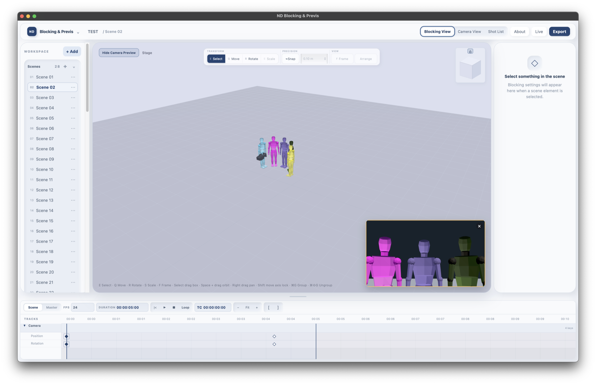
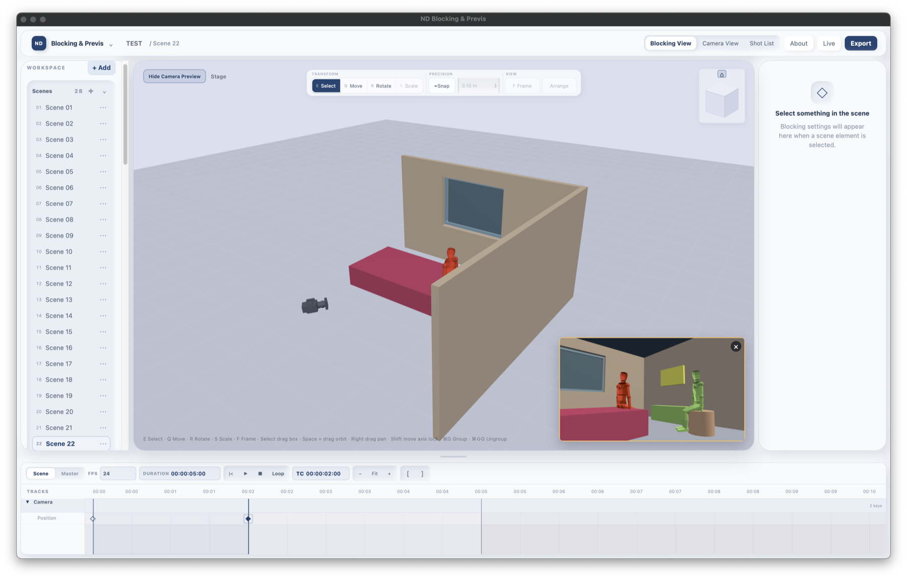
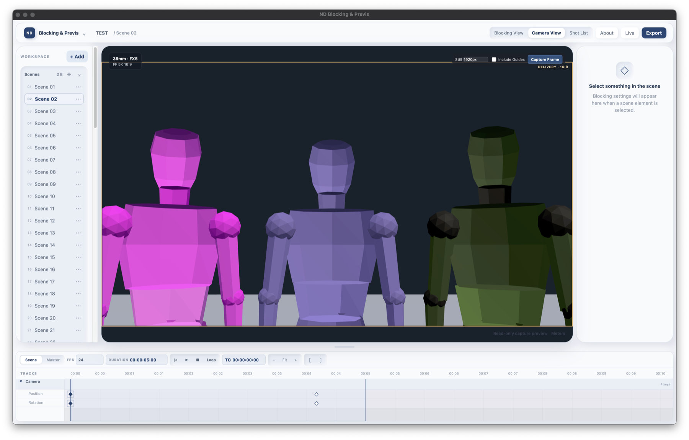
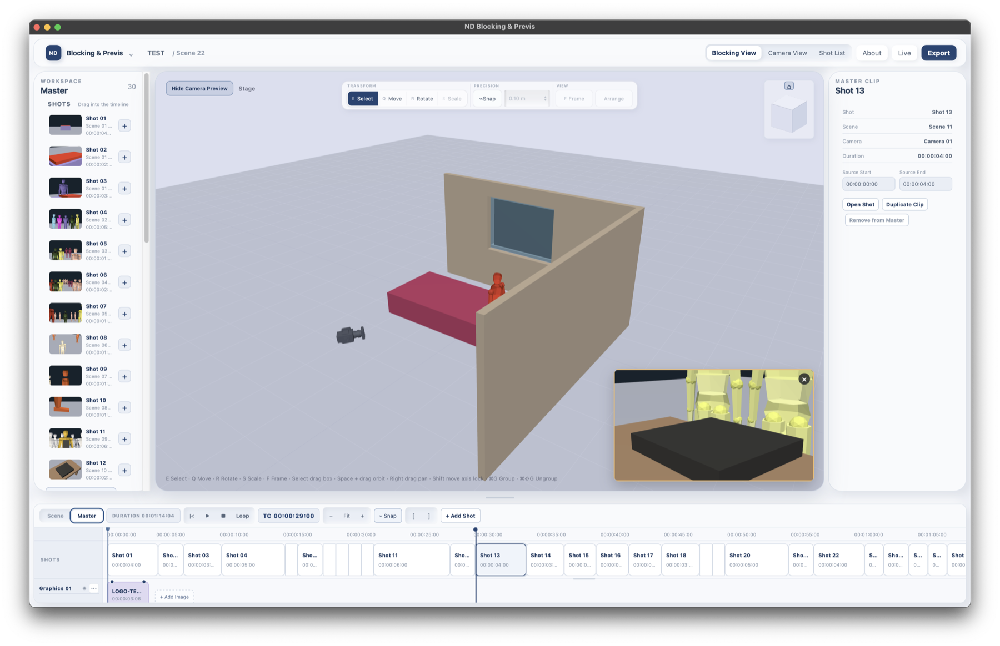

# ND Blocking & Previs

> **Plan the scene. Frame the shot.**

ND Blocking & Previs is a visual workspace for cinematographers and
directors to plan blocking, camera movement, shot composition, and sequences
before stepping onto set.

<p>
  <a href="https://blocking.duongtruongdp.net/">Open the Web App</a>
  &nbsp; · &nbsp;
  <a href="https://github.com/duongtruongdp/nd-blocking-previs/releases/latest/download/ND-Blocking-Previs-macOS-latest.zip"><strong>Download for macOS</strong></a>
  &nbsp; · &nbsp;
  <a href="https://github.com/duongtruongdp/nd-blocking-previs/releases/latest">View Latest Release</a>
</p>

**Current release:** `0.2.1` · **Desktop:** macOS Apple Silicon / arm64



The desktop build is distributed outside the Mac App Store and is currently
unsigned and not Apple-notarized. Windows installers are not published. See
the [macOS installation guide](docs/INSTALLATION_MACOS.md) for the normal
Finder security workflow.

## Overview

The workspace keeps spatial blocking, lens decisions, camera coverage, and
shot timing visible together. Build a scene, place actors and cameras, shape
individual shots, then assemble them into a master sequence for review and
export.

## Features

### Stage & Blocking

- Lightweight 3D blocking with procedural Actors and scenic Props.
- Walls, openings, vehicles, lights, groups, selection, and transform tools.
- Camera placement, framing, and readable spatial relationships.

### Camera & Framing

- Cinema-camera data, sensor areas, capture modes, focal length, and delivery
  frames.
- Camera Preview and Camera View with frame guides and shot composition tools.
- Camera movement blocking with position and rotation keyframes.

### Scene Timeline

- Timeline playback, playhead, Mark In/Out, keyframes, and camera paths.
- Position and rotation recording for scene blocking.

### Master Timeline

- Freeform Shot placement with intentional gaps.
- Snap On/Off, non-destructive trimming, multi-selection, and group movement.
- Graphics tracks, music, duplicate/delete workflows, and undo/redo.

### Graphics & Music

- Place graphics in the master sequence and preview them in context.
- Add music to the master timeline and review timing alongside shots.

### Export & Project Files

- Browser video export and native macOS H.264 MP4 export.
- Shot information burn-in, fades, and master-sequence export workflows.
- `.ndblock` editable projects and `.ndpack` portable packages with media.
- Shot List and Storyboard export to PDF, CSV, and XLSX.

## Application screenshots

### Stage blocking

Actors, scenic architecture, cameras, and the Camera Preview remain visible
in one working space.



### Camera View

Camera View shows the selected camera's actual framing, delivery guide, and
capture information.



### Master Timeline

The Master Timeline brings multiple Shots, Graphics, the playhead, and the
Master Shot Bin into one NLE-style review workspace.



## Master Timeline in v0.2.1

Version 0.2.1 focuses on a more natural, reliable editing workflow for the
Master Timeline:

- Place Shots independently and preserve intentional gaps.
- Toggle snapping when you need magnetic placement or frame-accurate edits.
- Trim Shot edges non-destructively within source and neighboring-shot limits.
- Select multiple Shots, move the group, duplicate, or delete it.
- Keep Graphics in their own track and place them in timeline gaps.
- Use undo and redo to review timing changes safely.
- Work at low zoom without artificial minimum Shot widths.

## Download

[Download the latest macOS Apple Silicon build](https://github.com/duongtruongdp/nd-blocking-previs/releases/latest/download/ND-Blocking-Previs-macOS-latest.zip)
or visit the [GitHub Releases page](https://github.com/duongtruongdp/nd-blocking-previs/releases).

The published desktop target is macOS Apple Silicon / arm64. Windows
installers are not currently published.

## Getting started

1. Download the macOS application or open the Web App.
2. Open an existing `.ndblock` project, or create a new project.
3. Add a Scene, Actors, Props, Architecture, and Cameras.
4. Arrange blocking and camera framing in the Stage.
5. Create Shots and assemble them in the Master Timeline.
6. Save the project, then export a still, video, Shot List, or portable
   package as needed.

## Project formats

- `.ndblock` is the normal editable project format. It stores the project,
  scenes, actors, props, cameras, shots, timelines, and settings.
- `.ndpack` is the portable project package. It bundles an `.ndblock` project
  with referenced media so the project can travel to another supported
  installation.

## Development

The application uses React, TypeScript, Vite, Three.js, and Tauri 2.

```bash
npm ci
npm run dev
npm test
npm run lint
npm run build
```

Desktop validation and the repeatable macOS release workflow are documented
in [`docs/BETA_RELEASE_WORKFLOW.md`](docs/BETA_RELEASE_WORKFLOW.md).

## Status and limitations

This is Beta software. The Web App and macOS Apple Silicon desktop build are
available for evaluation. Live Review and collaborative editing are Beta
workflow foundations, not a production-grade multi-user service.

The macOS application is unsigned and not Apple-notarized. macOS may require
the normal Finder **Open Anyway** approval on first launch. No global
Gatekeeper or system-security bypass is required.

## Support

Report reproducible issues through
[GitHub Issues](https://github.com/duongtruongdp/nd-blocking-previs/issues).
See [`SUPPORT.md`](SUPPORT.md) for what to include, and do not attach
confidential production projects by default. Security-sensitive reports
should follow [`SECURITY.md`](SECURITY.md).

## License

No `LICENSE` file is currently present. This repository does not make an
open-source licensing claim.

## Credits

ND Blocking & Previs is developed by **Dương Trương (Andy)**.

[duongtruongdp.net](https://duongtruongdp.net) ·
[ndtruong.contact@gmail.com](mailto:ndtruong.contact@gmail.com)
